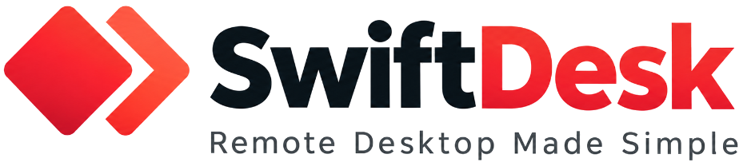
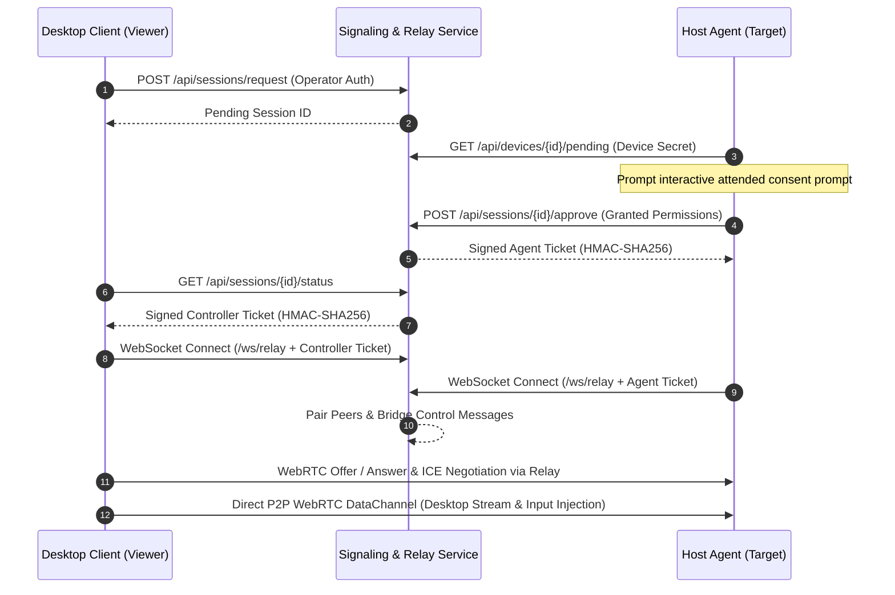

<div align="center">



<br />

**Enterprise-Grade, Cross-Platform Remote Support & Desktop Control**

[](https://dotnet.microsoft.com/en-us/download/dotnet/10.0)
[](https://learn.microsoft.com/en-us/dotnet/csharp/)
[](https://avaloniaui.net/)
[](https://webrtc.org/)
[](https://github.com/sahilyadav-01/SwiftDesk)
[](https://github.com/sahilyadav-01/SwiftDesk)
[](docs/security.md)

SwiftDesk provides secure, owner-consented remote support across Windows, Linux (Wayland & X11), and macOS. Engineered for low latency and enterprise compliance, it features real-time screen sharing, remote mouse and keyboard control, chunked integrity-checked file transfers, attended access consent, cryptographic session tickets, clustered relay fallback, and an isolated privileged remote reboot service.

[Architecture](#architecture-overview) • [Capabilities](#current-status--capabilities) • [Repository Structure](#repository-structure) • [Quickstart](#quickstart-running-swiftdesk-locally) • [Packaging](#cross-platform-packaging--installers) • [Enterprise Security](#enterprise-security--architecture) • [Configuration](#configuration-reference) • [License](#license--copyright)

</div>

---

## Table of Contents

- [Architecture Overview](#architecture-overview)
- [Current Status & Capabilities](#current-status--capabilities)
- [Repository Structure](#repository-structure)
- [Prerequisites](#prerequisites)
- [Build and Test](#build-and-test)
- [Quickstart: Running SwiftDesk Locally](#quickstart-running-swiftdesk-locally)
  - [1. Start Signaling Service](#1-start-the-signaling-server)
  - [2. Enroll and Start Host Agent](#2-enroll-and-start-the-agent-host-machine)
  - [3. Start Desktop Client](#3-start-the-desktop-client-viewer-machine)
  - [4. Connect and Control](#4-connect-and-control)
- [Enterprise Security & Architecture](#enterprise-security--architecture)
  - [Enterprise Production Identity (OIDC & MFA)](#enterprise-production-identity-oidc--mfa)
  - [Privileged Remote Reboot Service](#privileged-remote-reboot-service)
  - [Wayland Portal Integration (PipeWire & xdg-desktop-portal)](#wayland-portal-integration-pipewire--xdg-desktop-portal)
  - [Clustered Relay Fallback (Redis Pub/Sub Backplane)](#clustered-relay-fallback-redis-pubsub-backplane)
- [Cross-Platform Packaging & Installers](#cross-platform-packaging--installers)
  - [Windows MSI](#1-windows-msi-wix-toolset-v4)
  - [Linux Debian & RPM Packages](#2-linux-packages-debian--rpm)
  - [macOS Installer Package](#3-macos-installer-pkg--launchd)
- [Configuration Reference](#configuration-reference)
- [Production Deployment with Docker](#production-deployment-with-docker)
- [Security Invariants](#security-invariants)
- [License & Copyright](#license--copyright)

---

## Architecture Overview

SwiftDesk separates coordination, transport, platform adapters, and user interface into decoupled layers:

```
[Avalonia Desktop Client]                      [ASP.NET Core Signaling]                        [Host Agent]
(RemoteDesk.Client)                                (RemoteDesk.Signaling)                    (RemoteDesk.Agent)
         |                                                   |                                       |
         |--- 1. Authenticated Session Request ------------->|                                       |
         |                                                   |<-- 2. Attended Consent & Approval ----|
         |<-- 3. Short-Lived Signed Ticket ------------------|--- 3. Short-Lived Signed Ticket ----->|
         |                                                   |                                       |
         |=== 4. Paired WebSocket Control & Relay Channel ===|=======================================|
         |    (SDP Offer / Answer & ICE Candidates Trickle)  |                                       |
         |                                                   |                                       |
         |========================= 5. Direct WebRTC P2P Stream =====================================>|
         |                    (Ultra-low latency data channel / STUN NAT traversal)                  |
```

### Signaling & Data Session Lifecycle



---

## Current Status & Capabilities

| Capability | Status | Implementation Details |
| :--- | :---: | :--- |
| **Attended Approval & Consent** | **Implemented** | Interactive prompt on host agent; device owner explicitly approves requested permissions |
| **Fine-Grained Permissions** | **Implemented** | Independent granular toggles for `ViewScreen`, `ControlInput`, `TransferFiles`, `RebootDevice` |
| **Short-Lived Signed Tickets** | **Implemented** | Cryptographic HMAC-SHA-256 session tickets with constant-time verification & short expiry |
| **Paired WebSocket Relay** | **Implemented** | Low-latency binary/text message relay between paired peers with zero data leak |
| **WebRTC Media Transport** | **Implemented** | P2P ICE negotiation (`stun.l.google.com:19302`) via `SIPSorcery` with automatic relay fallback |
| **Windows Desktop Capture** | **Implemented** | High-performance desktop surface capture with real-time JPEG compression |
| **Windows Remote Input** | **Implemented** | Normalized coordinate translation & synthetic input injection via Win32 `SendInput` |
| **Linux Wayland Capture / Input** | **Implemented** | Wayland Portal capture (`org.freedesktop.portal.ScreenCast` & `libpipewire-0.3`) and `libei` input |
| **Linux X11 Capture / Input** | **Implemented** | X11 surface capture via `libX11` `XGetImage` & synthetic input via `libXtst` XTest |
| **macOS Desktop Capture / Input** | **Implemented** | CoreGraphics desktop capture & Quartz Event Services input injection |
| **Safe File Transfer** | **Implemented** | Chunked transfer (48 KiB limit), path-traversal protection, and SHA-256 validation |
| **Avalonia Desktop UI** | **Implemented** | Cross-platform client with real-time viewport, input capture, and file transfer manager |
| **Privileged Remote Reboot** | **Implemented** | Standalone daemon (`RemoteDesk.PrivilegedHelper`) via local IPC, HMAC validation, and rate limits |
| **Enterprise Identity & MFA** | **Implemented** | OpenID Connect (OIDC) JWT validation (RS256/HS256), `amr`/`acr` MFA enforcement, and RBAC |
| **Clustered Relay Backplane** | **Implemented** | Redis Pub/Sub relay backplane enabling horizontal scaling across multiple signaling nodes |
| **Database Persistence** | **Implemented** | Dual-mode: Production PostgreSQL (`Npgsql`) with connection pooling or in-memory for dev |
| **Immutable Audit Logging** | **Implemented** | Structured audit trail for enrollment, session approvals, and connection events (`/api/audit`) |

---

## Repository Structure

```text
SwiftDesk/
├── src/
│   ├── RemoteDesk.Client/            # Cross-platform Avalonia UI & screen viewport
│   ├── RemoteDesk.Agent/             # Host agent with owner consent & execution loop
│   ├── RemoteDesk.PrivilegedHelper/  # Standalone privileged daemon for secure remote reboot
│   ├── RemoteDesk.Core/              # Shared models, permission flags, and platform interfaces
│   ├── RemoteDesk.Protocol/          # Wire contracts, WebRTC messages, and validation
│   ├── RemoteDesk.Security/          # High-entropy secret generation & HMAC ticket signing
│   ├── RemoteDesk.Transport/         # WebRTC peer coordinator, WebSocket protocol & file receiver
│   ├── RemoteDesk.Signaling/         # ASP.NET Core coordination, heartbeat & clustered relay service
│   ├── RemoteDesk.Platform.Windows/  # Windows desktop capture & SendInput injection
│   ├── RemoteDesk.Platform.Linux/    # Linux Wayland/PipeWire and X11 capture & input adapter
│   └── RemoteDesk.Platform.MacOS/    # macOS CoreGraphics & Quartz Event Services adapter
├── tests/
│   ├── RemoteDesk.Core.Tests/        # Permission demand and authorization tests
│   ├── RemoteDesk.Protocol.Tests/    # Contract validation & WebRTC message tests
│   ├── RemoteDesk.Security.Tests/    # Ticket issuance & tamper-resistance tests
│   └── RemoteDesk.Signaling.Tests/   # Signaling lifecycle, OIDC validation, and Redis backplane tests
├── packaging/
│   ├── windows/                      # WiX v4 manifest (SwiftDesk.wxs) and PowerShell MSI builder
│   ├── linux/                        # Debian/RPM packaging, scripts, and hardened systemd service
│   └── macos/                        # macOS PKG packaging script, postinstall, and launchd daemon
├── docs/                             # Architecture, protocol, and security specifications
├── Dockerfile                        # Multi-stage production container build for signaling service
├── compose.yaml                      # Full-stack Docker Compose (Signaling + Postgres 17 + Redis 7)
└── RemoteDesk.slnx                   # Modern XML-based solution definition
```

---

## Prerequisites

- [.NET 10 SDK](https://dotnet.microsoft.com/en-us/download/dotnet/10.0) *(or the workspace's local runtime `work/.dotnet/dotnet.exe`)*
- Supported Operating Systems:
  - **Windows**: Windows 10/11 (x64 / ARM64)
  - **Linux**: Ubuntu 22.04+, Debian 12+, Fedora 38+, Arch Linux (Wayland or X11)
  - **macOS**: macOS Monterey 12+ (Apple Silicon or Intel)
- *(Optional for Production)*: [Docker & Docker Compose](https://www.docker.com/) for containerized signaling, PostgreSQL, and Redis.

---

## Build and Test

Using the .NET CLI or the workspace runner:

```powershell
# Restore dependencies across all projects
dotnet restore RemoteDesk.slnx

# Build the entire solution
dotnet build RemoteDesk.slnx --no-restore

# Run the complete test suite (47 unit and integration tests)
dotnet test RemoteDesk.slnx --no-build --no-restore
```

*(If using the workspace runtime on Windows, prefix with `.\work\.dotnet\dotnet.exe`)*

---

## Quickstart: Running SwiftDesk Locally

### 1. Start the Signaling Server

```powershell
dotnet run --project src/RemoteDesk.Signaling
```

The server initializes on `http://localhost:5080` with in-memory persistence by default.

### 2. Enroll and Start the Agent (Host Machine)

Open a terminal on the host machine and run:

```powershell
dotnet run --project src/RemoteDesk.Agent -- `
  --server http://localhost:5080 `
  --bootstrap-token local-bootstrap-change-me `
  --download-directory C:\Temp\SwiftDeskDownloads
```

On first launch, the agent enrolls the computer, receives a unique persistent device ID, and stores the credentials in the local user application data directory:
```text
Enrollment succeeded. This device now has a persistent SwiftDesk ID.
SwiftDesk ID: dev_01j7...
RemoteDesk agent dev_01j7... on Windows
Available permissions: ViewScreen, ControlInput, TransferFiles, RebootDevice
```

### 3. Start the Desktop Client (Viewer Machine)

In another terminal, launch the Avalonia UI:

```powershell
dotnet run --project src/RemoteDesk.Client
```

### 4. Connect and Control

1. Copy the ID from the host computer's **Your SwiftDesk ID** card and paste it into the client's **Remote device ID** field.
2. Toggle your requested permissions:
   - **View screen**: Streams the remote desktop.
   - **Control input**: Enables mouse movements, clicks, scroll, and keyboard events.
   - **Transfer files**: Enables secure file push to the host's configured destination directory.
   - **Reboot device**: Authorizes privileged remote reboot through the helper daemon.
3. Click **Request connection**.
4. In the Agent console, confirm the attended access prompt (`y`).
5. The live remote desktop stream will appear in the client viewport with full interactive control!

---

## Enterprise Security & Architecture

### Enterprise Production Identity (OIDC & MFA)
- **Token Verification**: Evaluates OpenID Connect (OIDC) JWT bearer tokens using asymmetric RSA public keys (`RS256`) or HMAC keys (`HS256`).
- **MFA Enforcement**: Evaluates `amr` (Authentication Methods Reference) and `acr` claims. Requests without verified multi-factor credentials (e.g., FIDO2, WebAuthn, OTP, hardware key) receive `403 Forbidden` (`mfa_required`).
- **Role-Based Access Control (RBAC)**: Validates enterprise operator roles (`SupportOperator`, `Administrator`).
- **Identity Attribution**: Binds operator identity to validated claims (`sub`, `name`, `email`) rather than client-supplied strings, guaranteeing an unforgeable PostgreSQL audit trail.

### Privileged Remote Reboot Service
- **Separation of Privilege**: The interactive user agent never runs with root/SYSTEM privileges. Screen capture and input injection remain strictly confined to the user session.
- **Dedicated Daemon**: A lightweight, standalone service (`RemoteDesk.PrivilegedHelper`) runs as a system service.
- **Audited IPC Protocol**: Communicates over local-only Named Pipes (Windows: `\\.\pipe\RemoteDesk.PrivilegedReboot`) or Unix Domain Sockets (Linux/macOS: `/run/swiftdesk/reboot.sock`) using length-prefixed framing.
- **Cryptographic Guarantees**:
  - Request HMAC-SHA256 signature using a machine-local root secret (`%ProgramData%\SwiftDesk\reboot.key` or `/etc/swiftdesk/reboot.key`).
  - Replay protection with tracked cryptographic nonces.
  - Strict ±30-second timestamp freshness window.
  - Input sanitization against shell and command injection.
  - Enforced 60-second rate-limiting cooldown to prevent reboot loops.

### Wayland Portal Integration (PipeWire & xdg-desktop-portal)
- **ScreenCast via PipeWire**: Coordinates with `org.freedesktop.portal.ScreenCast` over session D-Bus and probes `libpipewire-0.3.so.0` for Wayland compositors (GNOME Mutter, KDE KWin, Sway).
- **Remote Desktop & Input**: Dispatches input events through `org.freedesktop.portal.RemoteDesktop` and `libei`.
- **Hybrid Probing**: Detects session environment (`$WAYLAND_DISPLAY`, `$XDG_SESSION_TYPE`, `$DISPLAY`) and falls back cleanly to X11 when running under XWayland or traditional X11.

### Clustered Relay Fallback (Redis Pub/Sub Backplane)
- **Zero Sticky Sessions**: When peers in a session connect to different signaling nodes (e.g. Controller on Node 1, Agent on Node 2), traffic is bridged across nodes through `RedisRelayBackplane`.
- **Pub/Sub Channels**: Channels partitioned as `swiftdesk:relay:{sessionId}:{role}`.
- **Local Short-Circuit**: When both peers land on the same instance, messages are pumped in-memory with zero overhead.

---

## Cross-Platform Packaging & Installers

SwiftDesk includes production packaging workflows for Windows, Linux, and macOS, installing client binaries and registering the privileged helper daemon.

### 1. Windows MSI (WiX Toolset v4)

The Windows installer compiles via WiX v4 into an enterprise MSI package that installs application binaries, registers the `SwiftDeskPrivilegedHelper` Windows Service, and sets up restricted ACLs on `%ProgramData%\SwiftDesk`.

```powershell
# Build the Windows MSI installer
.\packaging\windows\build-msi.ps1 -Configuration Release

# Install silently (with automated Windows Service registration)
msiexec /i .\packaging\windows\SwiftDesk-1.0.0-Setup.msi /qn

# Verify the Windows Service status
Get-Service SwiftDeskPrivilegedHelper

# Uninstall
msiexec /x .\packaging\windows\SwiftDesk-1.0.0-Setup.msi /qn
```

### 2. Linux Packages (Debian & RPM)

The Linux packaging script publishes the client, agent, and privileged helper, generating standard `.deb` packages and hardened systemd unit definitions (`ProtectSystem=strict`, `NoNewPrivileges=yes`, `CapabilityBoundingSet=CAP_SYS_BOOT`).

```bash
# Build the Debian package (.deb)
chmod +x ./packaging/linux/build-linux-packages.sh
./packaging/linux/build-linux-packages.sh

# Install on Debian/Ubuntu
sudo dpkg -i ./packaging/linux/dist/swiftdesk_1.0.0_amd64.deb
sudo apt-get install -f # resolve any runtime dependencies (libpipewire-0.3, libxtst)

# Verify the hardened systemd reboot helper service
sudo systemctl status swiftdesk-privileged-reboot.service

# Uninstall
sudo apt-get remove swiftdesk
```

### 3. macOS Installer (.pkg & launchd)

The macOS packaging script publishes native binaries (universal / Apple Silicon), installs the application bundle to `/Applications/SwiftDesk.app`, and configures a system `launchd` daemon in `/Library/LaunchDaemons/`.

```bash
# Build the macOS PKG installer
chmod +x ./packaging/macos/build-macos-pkg.sh
./packaging/macos/build-macos-pkg.sh

# Install the package
sudo installer -pkg ./packaging/macos/dist/SwiftDesk-1.0.0.pkg -target /

# Verify the launchd daemon is running
sudo launchctl list | grep com.swiftdesk.privilegedhelper

# View helper daemon logs
tail -f /var/log/swiftdesk-helper.log
```

---

## Configuration Reference

The signaling service and agents are configured via environment variables or CLI flags:

### Signaling Service Environment Variables

| Variable | Default | Description |
| :--- | :--- | :--- |
| `RemoteDesk__BootstrapToken` | `local-bootstrap-change-me` | Secret token required for host agents to register their device ID. |
| `RemoteDesk__OperatorKey` | `local-operator-change-me` | Shared secret key for authenticating operator / controller sessions. |
| `RemoteDesk__SigningKey` | *(auto-generated)* | 256-bit key used to sign HMAC-SHA256 session tickets. |
| `RemoteDesk__PostgresConnection` | *(none / in-memory)* | PostgreSQL connection string. Enables persistent relational storage. |
| `RemoteDesk__RedisConnection` | *(none / local)* | Redis connection string (`host:port`). Enables clustered relay backplane. |
| `RemoteDesk__OidcIssuer` | *(disabled)* | OpenID Connect authority URL for verifying enterprise JWT tokens. |
| `RemoteDesk__OidcAudience` | *(disabled)* | Expected audience claim (`aud`) for enterprise JWT validation. |
| `RemoteDesk__RequireMfa` | `false` | When true, rejects sessions lacking MFA claims (`amr`/`acr`). |

### Host Agent Command-Line Options

```text
Usage: RemoteDesk.Agent [options]

Options:
  --server <URL>              Signaling server URL (default: http://localhost:5080)
  --bootstrap-token <TOKEN>   Bootstrap token for initial device enrollment
  --device-id <ID>            Pre-registered device ID (optional if enrolled)
  --device-secret <SECRET>    Pre-registered device secret
  --device-name <NAME>        Human-readable host display name
  --download-directory <PATH> Destination directory for approved file transfers
  --auto-approve-files        Automatically approve incoming file transfer requests
```

---

## Production Deployment with Docker

Deploy a production-ready, clustered SwiftDesk signaling server backed by PostgreSQL 17 and Redis 7:

```bash
# Set secure secrets
export REMOTEDESK_BOOTSTRAP_TOKEN="your-secure-bootstrap-token"
export REMOTEDESK_OPERATOR_KEY="your-secure-operator-key"
export REMOTEDESK_SIGNING_KEY="your-256bit-base64-signing-key"

# Launch signaling service, PostgreSQL, and Redis
docker compose up -d

# Check cluster logs and health
docker compose ps
docker compose logs -f signaling
```

---

## Security Invariants

- **Consent-First**: The host agent requires explicit owner approval for every session. Unattended access is never permitted without explicit authorization.
- **Least-Privilege Authorization**: Permissions are independently negotiated. The agent rejects ungranted actions even if signaled by the controller.
- **Short-Lived Signed Tickets**: Session tickets expire within minutes and are cryptographically verified using HMAC-SHA-256 with constant-time equality checks.
- **Path Traversal & Digest Verification**: Transferred files are validated against directory traversal, sanitized, chunk-limited (48 KiB), and verified against SHA-256 digests.
- **Process Privilege Isolation**: The user agent runs strictly as the logged-in desktop user. Privileged operations (reboot) are delegated to a dedicated daemon over authenticated local IPC.
- **No Covert Installation**: SwiftDesk does not silently install, bypass OS boundaries, or execute arbitrary shell commands.

---

## License & Copyright

```text
Copyright (c) 2026 Sahil Yadav. All rights reserved.
```

Licensed under the [Apache License, Version 2.0](LICENSE). You may obtain a copy of the License at:

```
http://www.apache.org/licenses/LICENSE-2.0
```

Unless required by applicable law or agreed to in writing, software distributed under the License is distributed on an "AS IS" BASIS, WITHOUT WARRANTIES OR CONDITIONS OF ANY KIND, either express or implied. See the [LICENSE](LICENSE) file for the specific language governing permissions and limitations.

---

<div align="center">
  <b>SwiftDesk</b> • Built with .NET 10 LTS and Avalonia UI<br />
  Copyright &copy; 2026 <b>Sahil Yadav</b>. All rights reserved.
</div>

