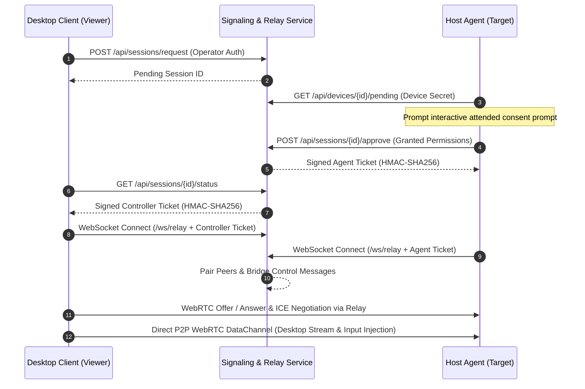

<div align="center">


<br />

**Enterprise-Grade, Cross-Platform Remote Support & Desktop Control**

[](https://github.com/sahilyadav-01/SwiftDesk/releases)
[](https://github.com/sahilyadav-01)
[](https://skonetechsupport.com/)
[](https://skonetechsupport.com/)
[](https://dotnet.microsoft.com/en-us/download/dotnet/10.0)
[](https://learn.microsoft.com/en-us/dotnet/csharp/)
[](https://avaloniaui.net/)
[](https://webrtc.org/)
[](https://github.com/sahilyadav-01/SwiftDesk)
[](https://github.com/sahilyadav-01/SwiftDesk)
[](SECURITY.md)
[](PRIVACY.md)
[](TERMS.md)
[](LICENSE)

SwiftDesk provides secure, owner-consented remote support across Windows, Linux (Wayland & X11), and macOS. Developed by **Sahil Yadav** and powered by **[SK ONE TECH](https://skonetechsupport.com/)**, it is engineered for low latency, enterprise compliance, real-time screen sharing, remote mouse and keyboard control, chunked integrity-checked file transfers, attended access consent, cryptographic session tickets, clustered relay fallback, and an isolated privileged remote reboot service.

[Architecture](#architecture-overview) • [Capabilities](#current-status--capabilities) • [Repository Structure](#repository-structure) • [Quickstart](#quickstart-running-swiftdesk) • [Packaging](#cross-platform-packaging--installers) • [Enterprise Security](#enterprise-security--architecture) • [Configuration](#configuration-reference) • [Support](#enterprise--technical-support) • [Privacy & Terms](#privacy-policy--terms-of-service) • [License](#license--copyright)

</div>

---

## Table of Contents

- [Architecture Overview](#architecture-overview)
- [Current Status & Capabilities](#current-status--capabilities)
- [Release Notes: v1.2.7](#release-notes-v127)
- [Release Notes: v1.2.6](#release-notes-v126)
- [Release Notes: v1.2.5](#release-notes-v125)
- [Repository Structure](#repository-structure)
- [Prerequisites](#prerequisites)
- [Build and Test](#build-and-test)
- [Quickstart: Running SwiftDesk](#quickstart-running-swiftdesk)
  - [Option A: Standalone Portable Executable (.exe)](#option-a-standalone-portable-executable-exe)
  - [Option B: Running from Source (.NET CLI)](#option-b-running-from-source-net-cli)
  - [Connecting Two Computers Across the Internet](#connecting-two-computers-across-the-internet)
- [Enterprise Security & Architecture](#enterprise-security--architecture)
  - [Enterprise Production Identity (OIDC & MFA)](#enterprise-production-identity-oidc--mfa)
  - [Privileged Remote Reboot Service](#privileged-remote-reboot-service)
  - [Wayland Portal Integration (PipeWire & xdg-desktop-portal)](#wayland-portal-integration-pipewire--xdg-desktop-portal)
  - [Clustered Relay Fallback (Redis Pub/Sub Backplane)](#clustered-relay-fallback-redis-pubsub-backplane)
- [Cross-Platform Packaging & Installers](#cross-platform-packaging--installers)
  - [Windows Standalone Single-File (.exe)](#1-windows-standalone-single-file-exe)
  - [Windows MSI (WiX Toolset v4)](#2-windows-msi-wix-toolset-v4)
  - [Linux Debian & RPM Packages](#3-linux-packages-debian--rpm)
  - [macOS Installer Package](#4-macos-installer-pkg--launchd)
- [Configuration Reference](#configuration-reference)
- [Production Deployment with Docker](#production-deployment-with-docker)
- [Free Cloud Deployment Options](#free-cloud-deployment-options)
- [Enterprise & Technical Support](#enterprise--technical-support)
- [Privacy Policy & Terms of Service](#privacy-policy--terms-of-service)
- [Security Invariants & Policy](#security-invariants--policy)
- [License & Copyright](#license--copyright)

---

## Architecture Overview

SwiftDesk separates coordination, transport, platform adapters, and user interface into decoupled layers:

```
[Avalonia Desktop Client]                      [ASP.NET Core Signaling]                        [Host Agent]
(RemoteDesk.Client)                                (RemoteDesk.Signaling)                    (RemoteDesk.Agent)
         |                                                   |                                       |
         |--- 1. Authenticated Session Request ------------->|                                       |
         |                                                   |<-- 2. Attended Consent & Approval ----|
         |<-- 3. Short-Lived Signed Ticket ------------------|--- 3. Short-Lived Signed Ticket ----->|
         |                                                   |                                       |
         |=== 4. Paired WebSocket Control & Relay Channel ===|=======================================|
         |    (SDP Offer / Answer & ICE Candidates Trickle)  |                                       |
         |                                                   |                                       |
         |========================= 5. Direct WebRTC P2P Stream =====================================>|
         |                    (Ultra-low latency data channel / STUN NAT traversal)                  |
```

### Signaling & Data Session Lifecycle



---

## Current Status & Capabilities

| Capability | Status | Implementation Details |
| :--- | :---: | :--- |
| **Attended Approval & Consent** | **Implemented** | Interactive prompt on host agent; device owner explicitly approves requested permissions |
| **Fine-Grained Permissions** | **Implemented** | Independent granular toggles for `ViewScreen`, `ControlInput`, `TransferFiles`, `RebootDevice` |
| **Short-Lived Signed Tickets** | **Implemented** | Cryptographic HMAC-SHA-256 session tickets with constant-time verification & short expiry |
| **Paired WebSocket Relay** | **Implemented** | Low-latency binary/text message relay between paired peers with zero data leak |
| **WebRTC Media Transport** | **Implemented** | P2P ICE negotiation (`stun.l.google.com:19302`) via `SIPSorcery` with automatic relay fallback |
| **Windows Desktop Capture** | **Implemented** | High-performance desktop surface capture with real-time JPEG compression |
| **Windows Remote Input** | **Implemented** | Normalized coordinate translation & synthetic input injection via Win32 `SendInput` |
| **Linux Wayland Capture / Input** | **Implemented** | Wayland Portal capture (`org.freedesktop.portal.ScreenCast` & `libpipewire-0.3`) and `libei` input |
| **Linux X11 Capture / Input** | **Implemented** | X11 surface capture via `libX11` `XGetImage` & synthetic input via `libXtst` XTest |
| **macOS Desktop Capture / Input** | **Implemented** | CoreGraphics desktop capture & Quartz Event Services input injection |
| **Safe File Transfer** | **Implemented** | Chunked transfer (48 KiB limit), path-traversal protection, and SHA-256 validation |
| **Avalonia Desktop UI** | **Implemented** | Cross-platform client with real-time viewport, input capture, and file transfer manager |
| **High-Performance Streaming Engine** | **Implemented** | Latest-frame UI conflation, acknowledged WebSocket relay frames, congestion-aware WebRTC delivery, 32 KiB SCTP chunking, and 55-quality GDI+ JPEG compression |
| **Privileged Remote Reboot** | **Implemented** | Standalone daemon (`RemoteDesk.PrivilegedHelper`) via local IPC, HMAC validation, and rate limits |
| **Enterprise Identity & MFA** | **Implemented** | OpenID Connect (OIDC) JWT validation (RS256/HS256), `amr`/`acr` MFA enforcement, and RBAC |
| **Clustered Relay Backplane** | **Implemented** | Redis Pub/Sub relay backplane enabling horizontal scaling across multiple signaling nodes |
| **Database Persistence** | **Implemented** | Dual-mode: Production PostgreSQL (`Npgsql`) with connection pooling or in-memory for dev |
| **Immutable Audit Logging** | **Implemented** | Structured audit trail for enrollment, session approvals, and connection events (`/api/audit`) |

---

## Release Notes: v1.2.7

- **Self-Contained Portable Executables (`.exe`)**:
  - Standalone single-file distributions for zero-install portability (`packaging/windows/standalone/SwiftDesk.exe` and `RemoteDesk.Agent.exe`).
  - Bundles the complete Avalonia UI, .NET 10 runtime, and native platform components into a single executable requiring no pre-installed dependencies.
  - Windows WiX v4 installer manifest updated producing `SwiftDesk-1.2.7-Setup.msi`.
- **Resilient Device Auto-Adoption**:
  - Implemented automatic enrollment and auto-adoption in the PostgreSQL persistence layer (`PostgresDeviceStore.AuthenticateAsync`).
  - Devices presenting valid 12-digit addresses and device secrets are automatically registered into PostgreSQL with zero-friction, preventing `401 Unauthorized` heartbeat rejection when deploying fresh database instances or connecting across migrating environments.
- **Resilient Host Agent Loop**:
  - Encapsulated session polling and request approvals in protective exception handling to prevent Agent termination from transient HTTP/Signaling glitches or temporary network drops.
  - Automatic reconnection, device state recovery, and continuous background listening without requiring manual host restarts.
- **Environment & Configuration Precision**:
  - Synchronized toolbar configuration with underlying agent processes: when configuring Signaling Server and Operator credentials in the GUI, both the Controller client and background Host Agent operate synchronously.
  - Added support for automated testing approval mode via `REMOTEDESK_AUTO_APPROVE`.
- Ships the updated Windows x64 MSI installer as `SwiftDesk-1.2.7-Setup.msi` and portable standalone binaries under `packaging/windows/standalone/`.

---

## Release Notes: v1.2.6

- Delivers fully functional and interactive navigation tabs: **Home**, **Favorites**, **Recent Sessions**, **Discovered**, and **Invitations**.
- **Home**: Interactive quick connect hero with live device address, 4 responsive quick-action feature cards, and recent connections overview.
- **Favorites**: Dedicated device bookmarking system with nickname aliases, persistent storage (`favorites.json`), and instant 1-click connect.
- **Recent Sessions**: Comprehensive connection history dashboard with connection timestamps, status badges, and 1-click reconnect.
- **Discovered**: Local network and signaling broker device discovery panel with network scanning and attended host readiness.
- **Invitations**: Attended consent policy enforcement and instant one-click session invitation sharing.
- **UI & Interaction Refinements**:
  - Centered text and content alignment across all primary and secondary buttons (`HorizontalContentAlignment = Center`, `VerticalContentAlignment = Center`) with hand cursor cues.
  - High-contrast **Copy Address** button with dynamic real-time click feedback (`"✓ Copied Address!"`).
  - Fixed badge layout stretch bug to prevent status pill overlap over card headers (`Grid.SetColumn(..., 1)`).
  - Replaced corrupted monochrome emoji glyphs on Windows desktop with crisp, modern typography.
- **Signaling & Connection Resilience**:
  - Registered `JsonStringEnumConverter` across ASP.NET Core Minimal APIs and client transport for robust flag-based permission serialization (`ViewScreen, ControlInput`).
  - Prioritized User environment variables over stale Machine-level tunnel cache traps.
  - Desktop client automatically spawns host agent passing its explicit `--server` endpoint for instant local pairing.
  - Enhanced Windows Attended Consent dialog with `MB_SYSTEMMODAL` and `MB_TOPMOST` flags to ensure approval prompts always appear in foreground.
- Ships updated self-contained Windows x64 MSI installer as `SwiftDesk-1.2.6-Setup.msi`.

---

## Release Notes: v1.2.5

- Prevents delayed remote-display updates by allowing only one acknowledged WebSocket relay frame in flight.
- Drops disposable WebRTC screen frames while the data-channel send buffer is busy, avoiding stale-frame buildup on slower connections.
- Keeps the controller viewport responsive by decoding and rendering only the newest pending frame.
- Ships the self-contained Windows x64 installer as `SwiftDesk-1.2.5-Setup.msi`.
- Aligns the application assembly metadata and MSI package version at `1.2.5`.

Validation: the complete test suite passes with 52 successful tests.

---

## Repository Structure

```text
SwiftDesk/
├── src/
│   ├── RemoteDesk.Client/            # Cross-platform Avalonia UI & screen viewport
│   ├── RemoteDesk.Agent/             # Host agent with owner consent & execution loop
│   ├── RemoteDesk.PrivilegedHelper/  # Standalone privileged daemon for secure remote reboot
│   ├── RemoteDesk.Core/              # Shared models, permission flags, and platform interfaces
│   ├── RemoteDesk.Protocol/          # Wire contracts, WebRTC messages, and validation
│   ├── RemoteDesk.Security/          # High-entropy secret generation & HMAC ticket signing
│   ├── RemoteDesk.Transport/         # WebRTC peer coordinator, WebSocket protocol & file receiver
│   ├── RemoteDesk.Signaling/         # ASP.NET Core coordination, heartbeat & clustered relay service
│   ├── RemoteDesk.Platform.Windows/  # Windows desktop capture & SendInput injection
│   ├── RemoteDesk.Platform.Linux/    # Linux Wayland/PipeWire and X11 capture & input adapter
│   └── RemoteDesk.Platform.MacOS/    # macOS CoreGraphics & Quartz Event Services adapter
├── tests/
│   ├── RemoteDesk.Core.Tests/        # Permission demand and authorization tests
│   ├── RemoteDesk.Protocol.Tests/    # Contract validation & WebRTC message tests
│   ├── RemoteDesk.Security.Tests/    # Ticket issuance & tamper-resistance tests
│   └── RemoteDesk.Signaling.Tests/   # Signaling lifecycle, OIDC validation, and Redis backplane tests
├── packaging/
│   ├── windows/                      # WiX v4 manifest (SwiftDesk.wxs) and PowerShell MSI builder
│   ├── linux/                        # Debian/RPM packaging, scripts, and hardened systemd service
│   └── macos/                        # macOS PKG packaging script, postinstall, and launchd daemon
├── docs/                             # Architecture, protocol, and security specifications
├── Dockerfile                        # Multi-stage production container build for signaling service
├── compose.yaml                      # Full-stack Docker Compose (Signaling + Postgres 17 + Redis 7)
└── RemoteDesk.slnx                   # Modern XML-based solution definition
```

---

## Prerequisites

- [.NET 10 SDK](https://dotnet.microsoft.com/en-us/download/dotnet/10.0) *(or the workspace's local runtime `work/.dotnet/dotnet.exe`)*
- Supported Operating Systems:
  - **Windows**: Windows 10/11 (x64 / ARM64)
  - **Linux**: Ubuntu 22.04+, Debian 12+, Fedora 38+, Arch Linux (Wayland or X11)
  - **macOS**: macOS Monterey 12+ (Apple Silicon or Intel)
- *(Optional for Production)*: [Docker & Docker Compose](https://www.docker.com/) for containerized signaling, PostgreSQL, and Redis.

---

## Build and Test

Using the .NET CLI or the workspace runner:

```powershell
# Restore dependencies across all projects
dotnet restore RemoteDesk.slnx

# Build the entire solution
dotnet build RemoteDesk.slnx --no-restore

# Run the complete test suite (52 unit and integration tests)
dotnet test RemoteDesk.slnx --no-build --no-restore
```

*(If using the workspace runtime on Windows, prefix with `.\work\.dotnet\dotnet.exe`)*

---

## Quickstart: Running SwiftDesk

### Option A: Standalone Portable Executable (.exe)

For instant zero-installation use on Windows:
1. Download or copy `SwiftDesk.exe` from `packaging/windows/standalone/` (or install via `SwiftDesk-1.2.7-Setup.msi`).
2. Double-click `SwiftDesk.exe` to launch the client GUI.
3. The application automatically starts the local agent in the background, displays your 12-digit SwiftDesk address, and is immediately ready to accept connections or connect to remote devices.

---

### Option B: Running from Source (.NET CLI)

#### 1. Start the Signaling Server
```powershell
dotnet run --project src/RemoteDesk.Signaling
```
The server initializes on `http://localhost:5080` (or your configured port/domain).

#### 2. Start the Desktop Client (Viewer / Host)
```powershell
dotnet run --project src/RemoteDesk.Client
```
The desktop client starts, initializes its local host agent, displays your 12-digit address (e.g., `686 171 244 053`), and displays **Ready**.

---

### Connecting Two Computers Across the Internet

To connect two computers across the internet (e.g., Host `624577650753` and Viewer `686 171 244 053`):

1. **Both computers must share the same Signaling Server & Operator Key**:
   - In the top settings toolbar of SwiftDesk on **both machines**, enter your public signaling server endpoint:
     - **Signaling server**: `https://your-signaling-domain.com` (or Cloudflare tunnel URL)
     - **Operator key**: `<your-configured-operator-key>`
     - **Operator name**: `Your Name / Organization`
2. **Verify Host Status**:
   - The remote host machine will show a green **● Ready** badge beside its 12-digit address.
3. **Initiate Connection**:
   - On the controller machine, enter the target's 12-digit address into **Connect to Remote Device** (e.g. `624577650753`).
   - Select desired permissions (**View screen**, **Control input**, **File transfer**, **Remote reboot**).
   - Click **Connect →**.
4. **Attended Consent**:
   - The remote machine receives an instant attended consent prompt.
   - Click **Allow / Accept**. The interactive remote desktop session begins immediately!

---

## Enterprise Security & Architecture

### Enterprise Production Identity (OIDC & MFA)
- **Token Verification**: Evaluates OpenID Connect (OIDC) JWT bearer tokens using asymmetric RSA public keys (`RS256`) or HMAC keys (`HS256`).
- **MFA Enforcement**: Evaluates `amr` (Authentication Methods Reference) and `acr` claims. Requests without verified multi-factor credentials (e.g., FIDO2, WebAuthn, OTP, hardware key) receive `403 Forbidden` (`mfa_required`).
- **Role-Based Access Control (RBAC)**: Validates enterprise operator roles (`SupportOperator`, `Administrator`).
- **Identity Attribution**: Binds operator identity to validated claims (`sub`, `name`, `email`) rather than client-supplied strings, guaranteeing an unforgeable PostgreSQL audit trail.

### Privileged Remote Reboot Service
- **Separation of Privilege**: The interactive user agent never runs with root/SYSTEM privileges. Screen capture and input injection remain strictly confined to the user session.
- **Dedicated Daemon**: A lightweight, standalone service (`RemoteDesk.PrivilegedHelper`) runs as a system service.
- **Audited IPC Protocol**: Communicates over local-only Named Pipes (Windows: `\\.\pipe\RemoteDesk.PrivilegedReboot`) or Unix Domain Sockets (Linux/macOS: `/run/swiftdesk/reboot.sock`) using length-prefixed framing.
- **Cryptographic Guarantees**:
  - Request HMAC-SHA256 signature using a machine-local root secret (`%ProgramData%\SwiftDesk\reboot.key` or `/etc/swiftdesk/reboot.key`).
  - Replay protection with tracked cryptographic nonces.
  - Strict ±30-second timestamp freshness window.
  - Input sanitization against shell and command injection.
  - Enforced 60-second rate-limiting cooldown to prevent reboot loops.

### Wayland Portal Integration (PipeWire & xdg-desktop-portal)
- **ScreenCast via PipeWire**: Coordinates with `org.freedesktop.portal.ScreenCast` over session D-Bus and probes `libpipewire-0.3.so.0` for Wayland compositors (GNOME Mutter, KDE KWin, Sway).
- **Remote Desktop & Input**: Dispatches input events through `org.freedesktop.portal.RemoteDesktop` and `libei`.
- **Hybrid Probing**: Detects session environment (`$WAYLAND_DISPLAY`, `$XDG_SESSION_TYPE`, `$DISPLAY`) and falls back cleanly to X11 when running under XWayland or traditional X11.

### Clustered Relay Fallback (Redis Pub/Sub Backplane)
- **Zero Sticky Sessions**: When peers in a session connect to different signaling nodes (e.g. Controller on Node 1, Agent on Node 2), traffic is bridged across nodes through `RedisRelayBackplane`.
- **Pub/Sub Channels**: Channels partitioned as `swiftdesk:relay:{sessionId}:{role}`.
- **Local Short-Circuit**: When both peers land on the same instance, messages are pumped in-memory with zero overhead.

---

## Cross-Platform Packaging & Installers

SwiftDesk includes production packaging workflows for Windows, Linux, and macOS, providing both portable single-file executables and enterprise system installers.

### 1. Windows Standalone Single-File (.exe)

For quick deployments without requiring administrative privileges or .NET runtime installation, SwiftDesk can be published as a self-contained portable single-file binary:

```powershell
# Build standalone portable GUI executable
dotnet publish src/RemoteDesk.Client/RemoteDesk.Client.csproj `
  -c Release -r win-x64 --self-contained true `
  -p:PublishSingleFile=true -p:IncludeNativeLibrariesForSelfExtract=true `
  -o packaging/windows/standalone

# Build standalone portable Host Agent executable
dotnet publish src/RemoteDesk.Agent/RemoteDesk.Agent.csproj `
  -c Release -r win-x64 --self-contained true `
  -p:PublishSingleFile=true -p:IncludeNativeLibrariesForSelfExtract=true `
  -o packaging/windows/standalone
```

The output executables:
- **`packaging/windows/standalone/SwiftDesk.exe`**: Complete desktop client GUI with auto-spawned host agent.
- **`packaging/windows/standalone/RemoteDesk.Agent.exe`**: Headless host agent for server environments or background automation.

### 2. Windows MSI (WiX Toolset v4)

The Windows installer compiles via WiX v4 into an enterprise MSI package that installs application binaries, registers the `SwiftDeskPrivilegedHelper` Windows Service, and sets up restricted ACLs on `%ProgramData%\SwiftDesk`.

The current Windows release is **v1.2.7**. Always pass the stable signaling URL explicitly when producing an installer for distribution (for example, your public domain or cloud URL).

Cloudflare Quick Tunnel URLs expire when their process stops. They are rejected by the MSI builder unless `-AllowEphemeralTunnel` is supplied for a temporary test build.

```powershell
# Build the Windows MSI installer (pre-configured with your signaling server & keys)
.\packaging\windows\build-msi.ps1 -Configuration Release `
  -ServerUrl "https://your-signaling-domain.com" `
  -BootstrapToken "your-bootstrap-token" `
  -OperatorKey "your-operator-key"

# Install silently (with automated Windows Service registration)
msiexec /i .\packaging\windows\SwiftDesk-1.2.7-Setup.msi /qn

# Verify the Windows Service status
Get-Service SwiftDeskPrivilegedHelper

# Uninstall
msiexec /x .\packaging\windows\SwiftDesk-1.2.7-Setup.msi /qn
```

### 3. Linux Packages (Debian & RPM)

The Linux packaging script publishes the client, agent, and privileged helper, generating standard `.deb` packages and hardened systemd unit definitions (`ProtectSystem=strict`, `NoNewPrivileges=yes`, `CapabilityBoundingSet=CAP_SYS_BOOT`).

```bash
# Build the Debian package (.deb)
chmod +x ./packaging/linux/build-linux-packages.sh
./packaging/linux/build-linux-packages.sh

# Install on Debian/Ubuntu
sudo dpkg -i ./packaging/linux/dist/swiftdesk_1.0.0_amd64.deb
sudo apt-get install -f # resolve any runtime dependencies (libpipewire-0.3, libxtst)

# Verify the hardened systemd reboot helper service
sudo systemctl status swiftdesk-privileged-reboot.service

# Uninstall
sudo apt-get remove swiftdesk
```

### 4. macOS Installer (.pkg & launchd)

The macOS packaging script publishes native binaries (universal / Apple Silicon), installs the application bundle to `/Applications/SwiftDesk.app`, and configures a system `launchd` daemon in `/Library/LaunchDaemons/`.

```bash
# Build the macOS PKG installer
chmod +x ./packaging/macos/build-macos-pkg.sh
./packaging/macos/build-macos-pkg.sh

# Install the package
sudo installer -pkg ./packaging/macos/dist/SwiftDesk-1.0.0.pkg -target /

# Verify the launchd daemon is running
sudo launchctl list | grep com.swiftdesk.privilegedhelper

# View helper daemon logs
tail -f /var/log/swiftdesk-helper.log
```

---

## Configuration Reference

The signaling service and agents are configured via environment variables or CLI flags:

### Signaling Service Environment Variables

Supports both flat standard (`REMOTEDESK_KEY`) and ASP.NET Core hierarchical (`RemoteDesk__Key`) conventions:

| Variable (Flat / Hierarchical) | Default | Description |
| :--- | :--- | :--- |
| `REMOTEDESK_BOOTSTRAP_TOKEN` / `RemoteDesk__BootstrapToken` | `local-bootstrap-change-me` | Secret token required for host agents to enroll their device ID. |
| `REMOTEDESK_OPERATOR_KEY` / `RemoteDesk__OperatorKey` | `local-operator-change-me` | Shared secret key for authenticating operator / controller sessions. |
| `REMOTEDESK_SIGNING_KEY` / `RemoteDesk__SigningKey` | *(auto-generated)* | 256-bit key used to sign HMAC-SHA256 session tickets (min 32 chars). |
| `REMOTEDESK_POSTGRES_CONNECTION` / `RemoteDesk__PostgresConnection` | *(none / in-memory)* | PostgreSQL connection string. Enables persistent relational storage. |
| `REMOTEDESK_REDIS_CONNECTION` / `RemoteDesk__RedisConnection` | *(none / local)* | Redis connection string (`host:port`). Enables clustered relay backplane. |
| `REMOTEDESK_OIDC_ISSUER` / `RemoteDesk__OidcIssuer` | *(disabled)* | OpenID Connect authority URL for verifying enterprise JWT tokens. |
| `REMOTEDESK_OIDC_AUDIENCE` / `RemoteDesk__OidcAudience` | *(disabled)* | Expected audience claim (`aud`) for enterprise JWT validation. |
| `REMOTEDESK_REQUIRE_MFA` / `RemoteDesk__RequireMfa` | `false` | When true, rejects sessions lacking MFA claims (`amr`/`acr`). |

### Host Agent Command-Line Options

```text
Usage: RemoteDesk.Agent [options]

Options:
  --server <URL>              Signaling server URL (default: http://localhost:5080)
  --bootstrap-token <TOKEN>   Bootstrap token for initial device enrollment
  --device-id <ID>            Pre-registered device ID (optional if enrolled)
  --device-secret <SECRET>    Pre-registered device secret
  --device-name <NAME>        Human-readable host display name
  --download-directory <PATH> Destination directory for approved file transfers
  --auto-approve-files        Automatically approve incoming file transfer requests
```

---

## Production Deployment with Docker

Deploy a production-ready, clustered SwiftDesk signaling server backed by PostgreSQL 17 and Redis 7:

```bash
# Set secure secrets
export REMOTEDESK_BOOTSTRAP_TOKEN="your-secure-bootstrap-token"
export REMOTEDESK_OPERATOR_KEY="your-secure-operator-key"
export REMOTEDESK_SIGNING_KEY="your-256bit-base64-signing-key"

# Launch signaling service, PostgreSQL, and Redis
docker compose up -d

# Check cluster logs and health
docker compose ps
docker compose logs -f signaling
```

---

## Free Cloud Deployment Options

The following non-Cloudflare hosts can run SwiftDesk's root [`Dockerfile`](Dockerfile) with public HTTPS and WebSocket support:

| Host | Free offering | Sleep behavior | Best use |
| --- | --- | --- | --- |
| [Northflank](https://northflank.com/) | Sandbox with up to two services; no card required | Always on | Recommended for SwiftDesk testing |
| [Koyeb](https://www.koyeb.com/) | One 512 MB free web service | Sleeps after one idle hour | Simple hobby deployment |
| [Oracle Cloud](https://www.oracle.com/cloud/free/) | Always Free compute VM | No normal app sleep; idle VMs can be reclaimed | Persistent, self-managed server |
| [Google Cloud Run](https://cloud.google.com/run) | Monthly request/CPU/memory allowance | Scales to zero | Short tests; active WebSockets consume allowance |

Northflank is the default recommendation because its free Sandbox is always-on and supports public WebSockets. Koyeb is the easiest fallback. Oracle requires Linux server administration and card verification. Cloud Run limits each WebSocket request to 60 minutes and can charge after its free compute allowance, so it is not the preferred SwiftDesk host.

First, generate three different secrets and save their values somewhere secure:

```powershell
function New-SwiftDeskSecret {
    $bytes = New-Object byte[] 32
    $generator = [Security.Cryptography.RandomNumberGenerator]::Create()
    try { $generator.GetBytes($bytes) } finally { $generator.Dispose() }
    [Convert]::ToBase64String($bytes)
}

$bootstrapToken = New-SwiftDeskSecret
$operatorKey = New-SwiftDeskSecret
$signingKey = New-SwiftDeskSecret

"Bootstrap token: $bootstrapToken"
"Operator key:    $operatorKey"
"Signing key:     $signingKey"
```

### Option A: Northflank Sandbox (recommended)

1. Push or fork this repository to GitHub.
2. Create a free **Sandbox** account at [Northflank](https://app.northflank.com/signup) and create a project.
3. Select **Create new service > Combined service** and connect the GitHub repository.
4. Choose the repository-root `Dockerfile` as the build method.
5. Select the smallest free Sandbox compute plan with one instance.
6. Add a public HTTP port `8080`. Northflank supplies the TLS-enabled `code.run` domain and supports WebSocket upgrades on this port.
7. Add these runtime variables as secrets:
   - `ASPNETCORE_ENVIRONMENT=Production`
   - `REMOTEDESK_BOOTSTRAP_TOKEN=<bootstrap token>`
   - `REMOTEDESK_OPERATOR_KEY=<operator key>`
   - `REMOTEDESK_SIGNING_KEY=<signing key>`
8. Deploy, then copy the generated `https://<service>.code.run` URL.

Verify the service:

```powershell
Invoke-RestMethod https://<service>.code.run/health
```

### Option B: Koyeb Free

1. Fork or push this repository to GitHub.
2. In the [Koyeb Control Panel](https://app.koyeb.com/), select **Create Web Service > GitHub** and connect the repository.
3. Select the **Dockerfile** builder and use the repository-root `Dockerfile`.
4. Select a **Web Service**, the **Free** instance, and the **Frankfurt** region.
5. Expose port `8080` using HTTP with the `/` route. Configure the health check path as `/health`.
6. Add these environment variables, using the values generated above and marking the three credentials as secrets:
   - `ASPNETCORE_ENVIRONMENT=Production`
   - `REMOTEDESK_BOOTSTRAP_TOKEN=<bootstrap token>`
   - `REMOTEDESK_OPERATOR_KEY=<operator key>`
   - `REMOTEDESK_SIGNING_KEY=<signing key>`
7. Deploy and copy the assigned public URL, such as `https://swiftdesk-<organization>.koyeb.app`.

Verify the deployment before connecting an agent or controller:

```powershell
Invoke-RestMethod https://<your-service>.koyeb.app/health
```

For either host, use its HTTPS URL as `--server` for both the Host Agent and Client, and as the MSI builder's `-ServerUrl` value. Use the bootstrap token with the Host Agent and the operator key with the Client.

### Option C: Oracle Cloud Always Free VM

After creating an Ubuntu Always Free VM with a public IPv4 address, add stateful TCP ingress rules for ports `80` and `443` to its network security group or subnet security list. Keep SSH port `22` restricted to your own public IP when possible; do not expose ports `5080`, `5432`, or `6379`.

Connect using the private key downloaded during instance creation:

```powershell
ssh -i "C:\path\to\ssh-key.key" ubuntu@<PUBLIC-IP>
```

On the VM, install Docker and clone SwiftDesk:

```bash
sudo apt-get update
sudo apt-get install -y docker.io docker-compose-v2 git
sudo systemctl enable --now docker
sudo usermod -aG docker "$USER"
git clone https://github.com/sahilyadav-01/SwiftDesk.git
cd SwiftDesk
cp .env.oracle.example .env.oracle
```

Sign out and reconnect so the Docker group membership takes effect. Edit `.env.oracle`, replace every placeholder, and convert the public IP dots to dashes in `SWIFTDESK_DOMAIN`. For example, public IP `203.0.113.10` becomes `swiftdesk.203-0-113-10.sslip.io`. Generate a separate random value for each credential.

Start the persistent stack and verify HTTPS:

```bash
docker compose --env-file .env.oracle -f compose.oracle.yaml up -d --build
docker compose --env-file .env.oracle -f compose.oracle.yaml ps
curl https://"$(grep '^SWIFTDESK_DOMAIN=' .env.oracle | cut -d= -f2)"/health
```

The Oracle stack exposes only Caddy on ports 80/443. Caddy obtains and renews a public TLS certificate, forwards HTTP and WebSocket traffic to SwiftDesk, and redirects HTTP to HTTPS. PostgreSQL data and Caddy certificates use named Docker volumes; PostgreSQL and Redis are not published on the VM's public network.

> [!IMPORTANT]
> Free hosting has no production availability guarantee. Koyeb scales to zero after one hour without Internet traffic; Northflank Sandbox resource limits can change; Oracle can reclaim an Always Free VM it considers idle. The Northflank and Koyeb configurations use in-memory SwiftDesk state, which resets whenever an instance restarts. The Oracle Compose configuration includes persistent PostgreSQL storage but still requires backups and operating-system maintenance.

---

## Enterprise & Technical Support

SwiftDesk is supported and backed by **[SK ONE TECH](https://skonetechsupport.com/)**, providing professional IT services, 24/7 technical support, infrastructure management, and enterprise remote support solutions.

- **Official Website**: [https://skonetechsupport.com/](https://skonetechsupport.com/)
- **Lead Developer & Maintainer**: **Sahil Yadav** ([GitHub @sahilyadav-01](https://github.com/sahilyadav-01))
- **Services Offered**:
  - 24/7 Managed IT Support & Helpdesk
  - Custom RemoteDesk / SwiftDesk Enterprise Deployment & SLA Support
  - Cloud Signaling & Relay Infrastructure Setup (Private Cloud / On-Premise)
  - Security Auditing, Compliance & Zero-Trust Access Configuration

For business inquiries, enterprise support agreements, or custom features, reach out via **[skonetechsupport.com](https://skonetechsupport.com/)**.

---

## Privacy Policy & Terms of Service

SwiftDesk is committed to ethical, transparent, and consent-first remote desktop software. Full legal documents are published in this repository:

- **[Privacy Policy (PRIVACY.md)](PRIVACY.md)**: Details our zero-surveillance architecture, what ephemeral data is processed during connections, our commitment to never store screen frames or keystrokes, and complete data ownership rights.
- **[Terms of Service (TERMS.md)](TERMS.md)**: Governs acceptable usage, open-source licensing under Apache 2.0, explicit prohibitions against covert access or malware deployment, and enterprise service boundaries.

### Key Highlights
- **100% Attended-Only Consent**: No session can start without the host machine owner clicking "Allow".
- **Zero Covert Surveillance**: No silent background screen streaming, keylogging, or webcam monitoring.
- **Direct P2P Privacy**: Media and control events flow over direct WebRTC peer-to-peer data channels whenever possible.
- **Data Sovereignty**: When deploying private signaling servers, all database records remain entirely under your organization's administrative control.

---

## Security Invariants & Policy

SwiftDesk follows strict zero-trust and consent-first engineering invariants. For vulnerability reporting procedures and disclosure timelines, see our [Security Policy](SECURITY.md). For complete cryptographic specifications and threat models, review [docs/security.md](docs/security.md).

- **Consent-First Attended Access**: The host agent requires explicit, interactive owner approval for every session. Unattended access is never permitted without explicit authorization.
- **Least-Privilege Authorization**: Permissions (`ViewScreen`, `ControlInput`, `TransferFiles`, `RebootDevice`) are independently negotiated. The agent rejects ungranted actions at the dispatch layer even if signaled by a controller.
- **Short-Lived Signed Tickets**: Session tickets expire within 5–10 minutes and are cryptographically signed using HMAC-SHA-256 with constant-time equality checks (`CryptographicOperations.FixedTimeEquals`).
- **Path Traversal & Digest Verification**: Transferred files are validated against directory traversal, sanitized, chunk-limited (48 KiB), and verified against SHA-256 digests before writing to disk.
- **Process Privilege Isolation**: The user agent runs strictly as the logged-in desktop user. Privileged operations (reboot) are delegated to a dedicated daemon (`RemoteDesk.PrivilegedHelper`) over authenticated local IPC with root key HMAC verification, nonces, and a 60-second cooldown.
- **Enterprise Identity & MFA**: Support for OIDC JWT bearer tokens (RS256/HS256) with mandatory MFA (`amr`/`acr`) enforcement and RBAC.
- **Zero Stealth / No Covert Installation**: SwiftDesk never operates invisibly, logs keystrokes outside active sessions, or bypasses operating system security boundaries.

---

## License & Copyright

```text
Copyright (c) 2026 Sahil Yadav (SK ONE TECH). All rights reserved.
Website: https://skonetechsupport.com/
```

Licensed under the [Apache License, Version 2.0](LICENSE). You may obtain a copy of the License at:

```
http://www.apache.org/licenses/LICENSE-2.0
```

Unless required by applicable law or agreed to in writing, software distributed under the License is distributed on an "AS IS" BASIS, WITHOUT WARRANTIES OR CONDITIONS OF ANY KIND, either express or implied. See the [LICENSE](LICENSE) file for the specific language governing permissions and limitations.

---

<div align="center">
  <b>SwiftDesk</b> • Built with .NET 10 LTS and Avalonia UI<br />
  Developed & Maintained by <b>Sahil Yadav</b> | Powered by <a href="https://skonetechsupport.com/"><b>SK ONE TECH</b></a><br />
  Official Support: <a href="https://skonetechsupport.com/">skonetechsupport.com</a><br />
  Copyright &copy; 2026 <b>Sahil Yadav (SK ONE TECH)</b>. All rights reserved.
</div>

