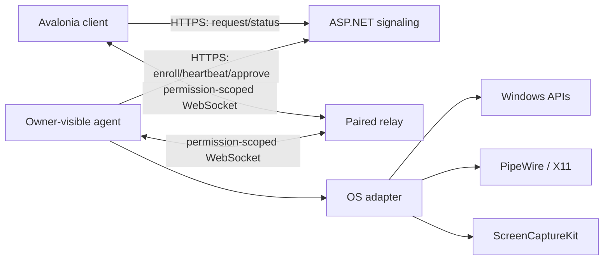
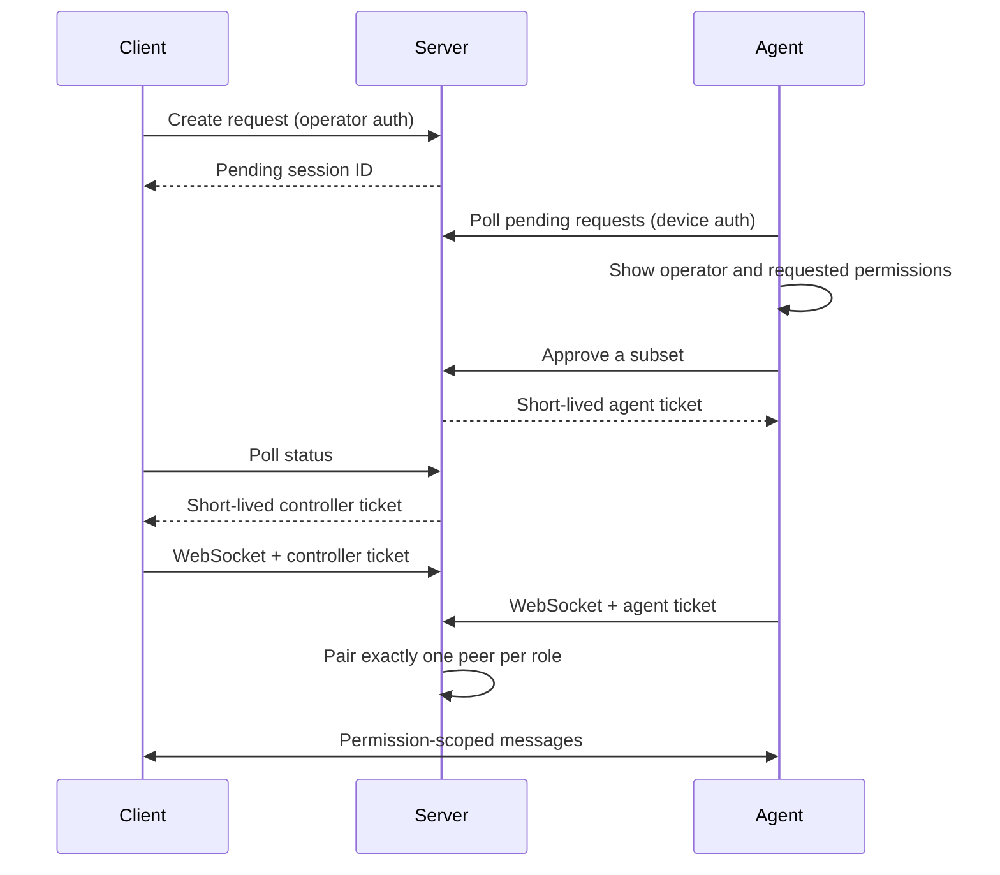

# Architecture

## Runtime topology

The signaling service coordinates identities and consent. A controller and agent receive different signed tickets for one session. The relay accepts exactly one peer in each role and forwards framed WebSocket messages without interpreting their content.

For production screen media, replace the WebSocket media path with WebRTC. Signaling should exchange offers, answers, and ICE candidates; media should go peer-to-peer when possible and through TURN only when necessary.

## Session lifecycle

Tickets include the session ID, device ID, role, granted permissions, issue/expiry timestamps, and a random token ID. They are signed with HMAC-SHA-256 and checked using constant-time signature comparison.

## Project responsibilities

- `Core` has no network or UI dependency. It defines permission semantics and OS adapter contracts.
- `Protocol` owns bounded wire contracts and input/path validation.
- `Security` owns high-entropy credentials and signed session tickets.
- `Transport` owns framing, the HTTP client, and safe file assembly.
- `Signaling` owns enrollment/session state and relay pairing.
- `Agent` enforces the granted permission again before every sensitive operation.
- Platform projects are the only place native capture, input, and reboot code should live.

## Data-store seam

The current registries are process-local so the first milestone is easy to run. Replace them with PostgreSQL repositories before using more than one signaling instance. Session approval must be a compare-and-swap transaction so a request cannot be approved twice under race.

